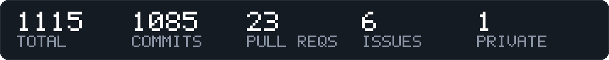

<picture>
<source media="(prefers-color-scheme: light)" srcset="https://www.gitskins.com/api/section/pixel-room?username=satyam-umrao&mode=light" />

</picture>

<!--STATS:START-->
<picture>
<source media="(prefers-color-scheme: light)" srcset="assets/stats-light.svg" />

</picture>
<!--STATS:END-->

<picture>
<source media="(prefers-color-scheme: light)" srcset="https://www.gitskins.com/api/section/pixel-header?username=satyam-umrao&title=%3E+Projects&mode=light" />

</picture>

<!--PROJECTS:START-->
<a href="https://github.com/satyam-umrao/My-portfolio"><picture><source media="(prefers-color-scheme: light)" srcset="https://www.gitskins.com/api/section/pixel-card?username=satyam-umrao&i=0&r=My-portfolio&mode=light" /></picture></a>
<a href="https://github.com/satyam-umrao/Task_manager"><picture><source media="(prefers-color-scheme: light)" srcset="https://www.gitskins.com/api/section/pixel-card?username=satyam-umrao&i=1&r=Task_manager&mode=light" /></picture></a>
<a href="https://github.com/satyam-umrao/github-profile-readme-maker"><picture><source media="(prefers-color-scheme: light)" srcset="https://www.gitskins.com/api/section/pixel-card?username=satyam-umrao&i=2&r=github-profile-readme-maker&mode=light" /></picture></a>
<a href="https://github.com/satyam-umrao/Java"><picture><source media="(prefers-color-scheme: light)" srcset="https://www.gitskins.com/api/section/pixel-card?username=satyam-umrao&i=3&r=Java&mode=light" /></picture></a>
<!--PROJECTS:END-->

&nbsp;&nbsp;&nbsp;&nbsp;
&nbsp;&nbsp;&nbsp;&nbsp;

