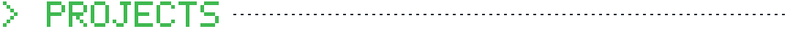
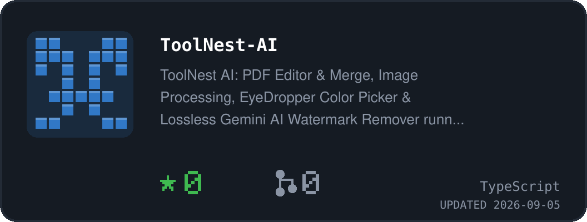
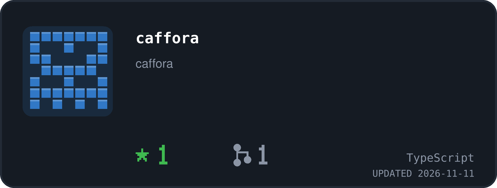
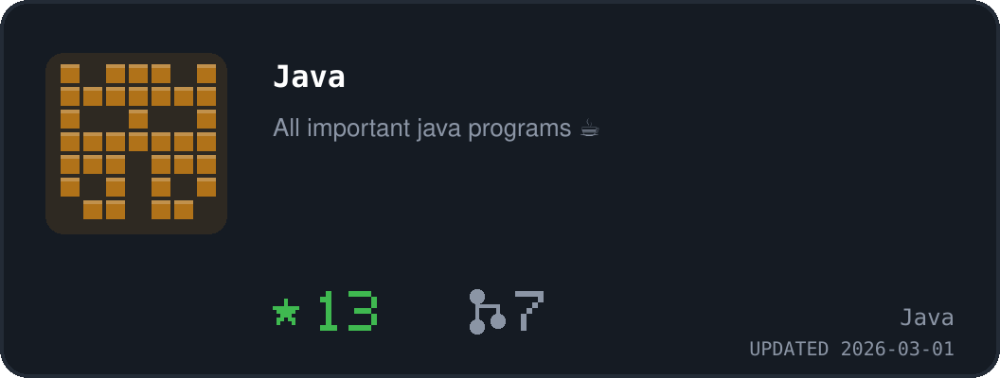
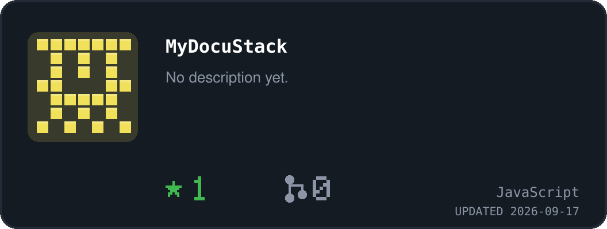

<picture>
<source media="(prefers-color-scheme: light)" srcset="assets/header-light.svg" />

</picture>

<picture>
<source media="(prefers-color-scheme: light)" srcset="assets/stats-light.svg" />

</picture>

<picture>

<source media="(prefers-color-scheme: light)" srcset="assets/projects-light.svg" />

</picture>

<!--PROJECTS:START-->
<a href="https://github.com/satyam-umrao/ToolNest-AI"><picture><source media="(prefers-color-scheme: light)" srcset="assets/cards/toolnest-ai-light.svg" /></picture></a>
<a href="https://github.com/satyam-umrao/caffora"><picture><source media="(prefers-color-scheme: light)" srcset="assets/cards/caffora-light.svg" /></picture></a>
<a href="https://github.com/satyam-umrao/Java"><picture><source media="(prefers-color-scheme: light)" srcset="assets/cards/java-light.svg" /></picture></a>
<a href="https://github.com/satyam-umrao/MyDocuStack"><picture><source media="(prefers-color-scheme: light)" srcset="assets/cards/mydocustack-light.svg" /></picture></a>
<!--PROJECTS:END-->

<h3>&nbsp;Connect with me</h3>
&nbsp;&nbsp;&nbsp;&nbsp;
&nbsp;&nbsp;&nbsp;&nbsp;

